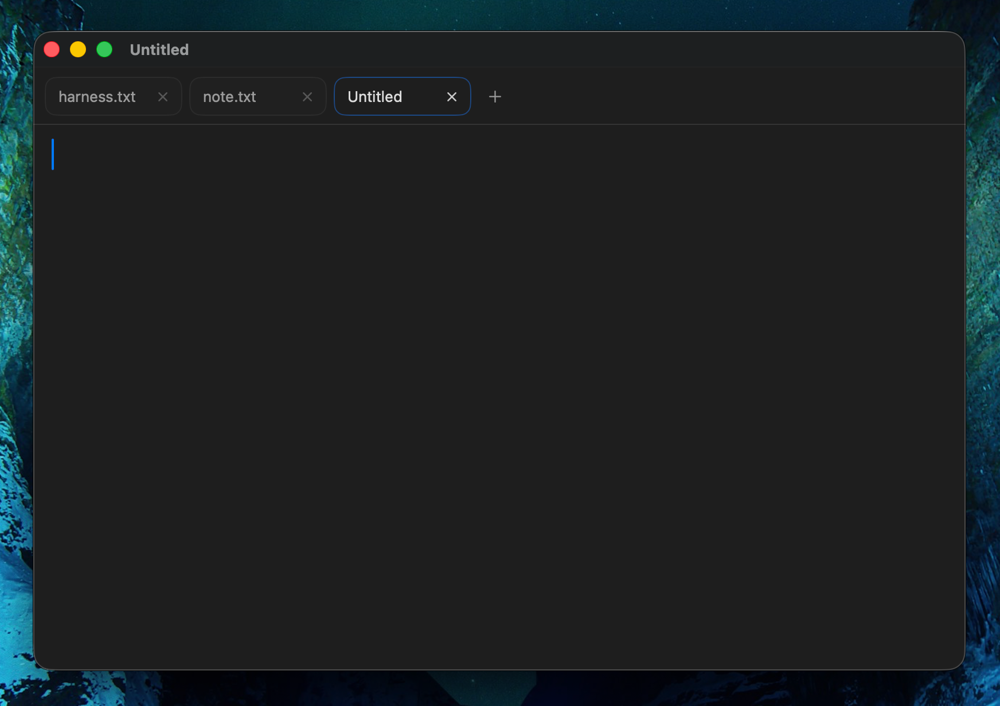

# mac-notepad

`mac-notepad` is a small native macOS plain-text editor built with SwiftUI and a lightweight web-based editor surface.

It keeps the app intentionally simple: plain text only, manual save/open, lightweight tabs, adjustable font and line height, word wrap, and a minimal Mac-style UI.



## Features

- Native macOS app with a standalone `.app` bundle build script
- Plain-text editing with no rich text, preview, sidebar, or autosave
- Multiple tabs in one window
- Adjustable font, font size, line height, and word wrap
- Lightweight find/replace bar
- Drag-and-drop `.txt` opening
- Built-in Myanmar font options for Burmese text
- `.txt` file association support for Finder and `Open With`

## Build

Requires macOS and Xcode with Swift 6.3 or later.

```bash
swift test
./scripts/build_app.sh
open dist/Notepad.app
```

To verify the app is portable after copying to `/Applications`, run:

```bash
./scripts/verify_portable_app.sh
```

## DMG Installer

Download an installer from [GitHub Releases](https://github.com/eimg/mac-notepad/releases), open the DMG, and drag `Notepad.app` onto `Applications`. Eject the disk image and open Notepad from Applications. Requires macOS 13 or later.

To build an installer locally for both Apple silicon and Intel Macs:

```bash
APP_VERSION=1.0.0 BUILD_NUMBER=1 ./scripts/build_dmg.sh
```

This creates `dist/Notepad-1.0.0-universal.dmg` and a `.sha256` checksum file. The script verifies the disk image, bundled resources, app signature, version, and both executable architectures before producing the checksum. Generated installers are ignored by Git; the existing `dist/Notepad.app` is kept intact.

For a smaller installer targeting one architecture, set `BUILD_ARCH=arm64` or `BUILD_ARCH=x86_64`. Without `APP_VERSION` and `BUILD_NUMBER`, the scripts use the values in `App/Info.plist`. `build_app.sh` also accepts these settings and defaults to building for the current Mac.

These builds use ad-hoc signing and are **not notarized by Apple**. macOS may block a downloaded copy on first launch. If you trust its source, attempt to open it, then go to **System Settings → Privacy & Security → Open Anyway**. Developer ID signing and notarization require an Apple Developer account and are not configured in this workflow.

Verify a downloaded checksum from the folder containing both files:

```bash
shasum -a 256 -c Notepad-1.0.0-universal.dmg.sha256
```

## Releases

The [release workflow](.github/workflows/release.yml) runs tests, builds and verifies a universal DMG, and publishes it with its checksum and generated release notes when a `vMAJOR.MINOR.PATCH` tag is pushed. Commit and push the workflow and packaging scripts before creating the first release tag:

```bash
git tag -a v1.0.0 -m "Notepad 1.0.0"
git push origin v1.0.0
```

Use a new version tag for each release. The tag sets the bundled app version; the Actions run number sets its build number. The workflow uses the repository's built-in `GITHUB_TOKEN` with `contents: write`; no release token secret is needed.

To test packaging without publishing, open **Actions → Release → Run workflow**, enter a numeric version such as `1.0.0`, and download the installer from the run's artifacts.

## Quick Test

If you just want to try the app without building it yourself, the repository also includes a ready-to-run copy at `dist/Notepad.app`.

After cloning the repo:

```bash
open dist/Notepad.app
```

## Tech

- Swift Package Manager
- SwiftUI for app structure and tab UI
- `WKWebView` + CodeMirror for the editing surface
- AppKit for native macOS windowing, menus, and file integration
